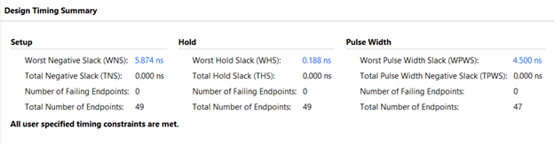
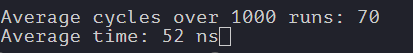
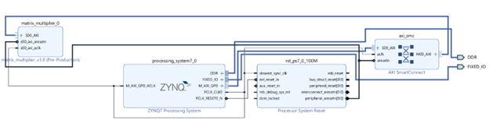
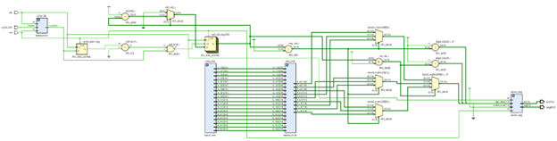
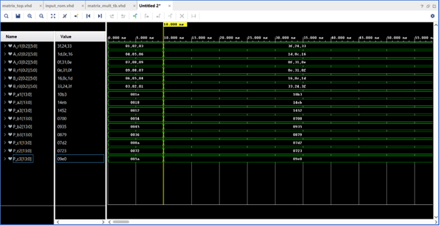
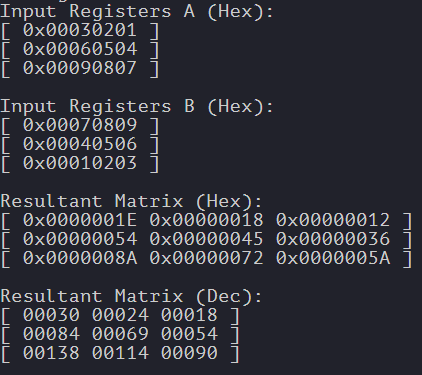

# 3x3 Matrix Multiplier: AXI4-Lite Peripheral and Nexys A7 Demo

A combinational 3x3 unsigned matrix multiplier in VHDL (6-bit elements,
14-bit results), built two ways:

- as an AXI4-Lite peripheral for a Zynq-7000 (ZedBoard), with a bare-metal C
  program that writes two matrices and prints the product;
- as a stand-alone design for a Digilent Nexys A7-100T that multiplies two
  constant matrices and shows the result on the seven-segment display.

## What is hand-written and what is generated

| Part | Files | Origin |
|------|-------|--------|
| Multiplier core | `rtl/common/multiplier.vhd` (`p <= a * b`), `rtl/common/ripple_carry_adder.vhd`, `rtl/axi/matrix_mult.vhd`, `rtl/nexys_a7/matrix_mult.vhd`, `rtl/nexys_a7/matrix_pkg.vhd` | Hand-written |
| Nexys A7 demo | `rtl/nexys_a7/input_rom.vhd`, `debouncer.vhd`, `seven_seg.vhd`, `matrix_top.vhd`, `constraints/nexys_a7.xdc` | Hand-written |
| Testbenches | `tb/*.vhd`, `scripts/run_tests.sh` | Hand-written |
| C program | `sw/matrix_multiplier/src/mm.c` | Hand-written |
| AXI4-Lite slave | `vivado/ip_repo/matrix_multiplier_1_0/hdl/*.vhd` | Vivado's "Create and Package New IP" template. The hand edits are the user-logic section that instantiates `matrix_mult` and the nine result registers, which are loaded from the core instead of from the bus. |
| IP packaging and driver | the rest of `vivado/ip_repo/matrix_multiplier_1_0/` (`component.xml`, `xgui/`, `bd/`, `example_designs/`, `drivers/`) | Vivado-generated. The driver is the generated stub: register offsets, read/write macros and a self-test; `matrix_multiplier.c` contains no functions. `mm.c` does not use it. |
| Block design and projects | `vivado/Block_Design/` (`.bd`, `.xci`, `.xpr`, exported `.xsa`), `vivado/Pure_VHDL/Pure_VHDL.xpr` | Vivado-generated |
| Vitis application scaffolding | `sw/matrix_multiplier/` except `mm.c` (`platform.c`, `platform.h`, CMake files, linker script) | Vitis `hello_world` template |

The arithmetic itself is small: 27 products, each a single `*` on two 6-bit
operands, and two 14-bit ripple-carry adders per result element.

## Repository layout

```
rtl/common/     multiplier and ripple-carry adder shared by both builds
rtl/axi/        matrix_mult with 32-bit packed row ports, used by the AXI IP
rtl/nexys_a7/   matrix_mult with array-typed ports, plus the Nexys A7 demo
tb/             self-checking testbenches
constraints/    Nexys A7 pin and clock constraints
sw/             Vitis application component (bare-metal C)
scripts/        test runner
docs/images/    screenshots referenced below
docs/reports/   Vivado timing and utilisation reports referenced below
vivado/         Vivado-generated files: packaged IP, block design, projects
```

There are two `matrix_mult` entities because the two builds pass matrices
differently (packed register words versus VHDL arrays). The arithmetic in
both is the same, and each has its own testbench.

## Register map (AXI4-Lite peripheral)

32-bit registers, word-aligned offsets from the peripheral base address.

| Offset | Register | Access | Contents |
|--------|----------|--------|----------|
| `0x00`-`0x08` | `slv_reg0`-`slv_reg2` | read/write | rows 1-3 of A |
| `0x0C`-`0x14` | `slv_reg3`-`slv_reg5` | read/write | rows 1-3 of B |
| `0x18`-`0x38` | `slv_reg6`-`slv_reg14` | read-only | A x B, row by row: P11, P12, P13, P21, ... P33 |

- A row register holds one element per byte: column 1 in bits 5:0, column 2
  in bits 13:8, column 3 in bits 21:16. The other bits are stored and read
  back but ignored by the multiplier.
- A result register holds the sum in bits 13:0 and the carry out of the last
  adder in bit 14. The largest possible result is 3 x 63 x 63 = 11907, so
  the carry is always 0.
- The core is combinational. The result registers capture its outputs on
  every clock edge; there is no start or done bit.

## Verification

```sh
scripts/run_tests.sh
```

needs GHDL on the `PATH` (or `GHDL=/path/to/ghdl`). To run it in the
container CI uses:

```sh
docker run --rm -v "$PWD":/src -w /src ghdl/ghdl:5.0.1-mcode-ubuntu-24.04 sh scripts/run_tests.sh
```

The script analyses the hand-written VHDL with `--std=08 -Wall -Werror`
and runs three testbenches. A failed assertion ends the run with a non-zero
exit status.

| Testbench | Design under test | What it checks |
|-----------|-------------------|----------------|
| `matrix_mult_tb` | `rtl/nexys_a7/matrix_mult.vhd` | 9 corner cases (zero, all-63, identity, asymmetric) and 500 random matrix pairs against a product computed in the testbench |
| `matrix_multiplier_axi_tb` | the packaged peripheral: Vivado's AXI slave with `rtl/axi/matrix_mult.vhd` | through AXI4-Lite transactions only: registers read zero after reset, input registers read back, 7 directed and 100 random products, unused field bits are ignored, result registers are read-only, write strobes |
| `matrix_top_tb` | `rtl/nexys_a7/matrix_top.vhd` | after reset, all eight display digits show the first cell of the ROM product |

Not covered: the cycle button and its debouncer, back-to-back or stalled
AXI transfers, and anything on hardware.

Style checks:

```sh
pip install vsg==3.35.0 clang-format==22.1.8
vsg -c vsg.yaml
clang-format --dry-run --Werror sw/matrix_multiplier/src/mm.c
```

The VHDL follows the rule set documented by
[VHDL Style Guide](https://vhdl-style-guide.readthedocs.io) (vsg defaults).
`vsg.yaml` lists the few rules that deviate and why. Vivado-generated files
are not style-checked and are analysed by GHDL as generated.

GitHub Actions runs the style checks and `scripts/run_tests.sh` on every
push and pull request.

## Timing and utilisation: what the committed results show

The reports in `docs/reports/` are Vivado 2025.1 output from the builds of
20 November 2025, restored unmodified from this repository's first commit.
The sources committed alongside them have not changed in logic since.

**Zynq build: the multiplier between registers.** In the peripheral the
multiplier sits between the input registers and the result registers, so
its delay is on a clocked path. The PL clock `clk_fpga_0` is constrained to
10 ns (100 MHz).
[`zynq_design_1_wrapper_timing_summary_routed.rpt`](docs/reports/zynq_design_1_wrapper_timing_summary_routed.rpt)
reports, after routing, a worst negative slack of 0.327 ns and a worst hold
slack of 0.054 ns, with all constraints met. The worst path runs from
`slv_reg0[18]` through the multiplier to `slv_reg7[11]`: 9.574 ns of data
path delay (3.196 ns logic, 6.378 ns routing) over 11 logic levels. The
unpipelined multiplier therefore uses almost the whole 100 MHz period.

[`zynq_design_1_matrix_multiplier_0_7_utilization_synth.rpt`](docs/reports/zynq_design_1_matrix_multiplier_0_7_utilization_synth.rpt)
is the out-of-context synthesis of the whole peripheral for the
`xc7z020`: 1303 LUTs, 336 registers, 28 F7 muxes, no DSP blocks and no
block RAM.

**Nexys A7 build: not a measurement of the multiplier.**
`constraints/nexys_a7.xdc` constrains the clock to 10 ns. The screenshot
shows a worst negative slack of 5.874 ns, a worst hold slack of 0.188 ns
and 49 setup endpoints.



In this build the matrices are constants in `input_rom.vhd`, so the products
can be computed at synthesis time, and the results go to the display pins
without a register after them, so no clock-to-clock path runs through the
multiplier.
[`matrix_top_timing_summary_routed.rpt`](docs/reports/matrix_top_timing_summary_routed.rpt),
from another run of the same design (5.800 ns slack), shows that the worst
path is inside the display scan counter (`seven_seg/tick_count_reg[8]` to
`tick_count_reg[0]`).

**What the C program measures.** The block design sets the CPU clock to
666.67 MHz. `mm.c` writes the two matrices once and then times a single
AXI4-Lite read of result register 6 with `XTime_GetTime`, averaged over
1000 reads. The inputs are not rewritten inside the loop, so the figure is
the cost of one register read from the ARM core, not of a multiplication.



The screenshot shows the program printing an average of 70 timer counts,
which it converts to 52 ns with the BSP constant `COUNTS_PER_SECOND`. The
BSP is not part of this repository and that conversion has not been
checked against the timer's actual frequency.

None of these builds has been re-run since the cleanup.

## Other screenshots

- Block design (Zynq PS, AXI SmartConnect, reset block, `matrix_multiplier`):
  
- Elaborated schematic of the Nexys A7 top level:
  
- Vivado simulation of `matrix_mult`. The outputs change together with the
  inputs, so it shows function, not delay:
  
- Program output for A = [[1,2,3],[4,5,6],[7,8,9]] and
  B = [[9,8,7],[6,5,4],[3,2,1]]:
  

## Building for hardware

Built with Vivado and Vitis 2025.1. These flows were last run before the
sources were moved into the layout above; the project files reference the
new paths but have not been reopened in Vivado since.

**Zynq (ZedBoard, `xc7z020clg484-1`)**

1. Open `vivado/Block_Design/Block_Design.xpr`. It takes the peripheral from
   `vivado/ip_repo/`. Generate the bitstream and export the hardware, or use
   the committed `vivado/Block_Design/zynq_design_1_wrapper.xsa`.
2. In Vitis, open `sw/` as the workspace and create a platform component
   named `Mult` from the XSA (standalone, `ps7_cortexa9_0`).
3. Build the `matrix_multiplier` application component and run it on the
   board. Output is on the PS UART at 115200 baud.
4. To try other matrices, edit the `pack()` calls in `mm.c` (elements must
   be 0-63).

**Nexys A7-100T (`xc7a100tcsg324-1`)**

1. Open `vivado/Pure_VHDL/Pure_VHDL.xpr`, generate the bitstream and program
   the board.
2. The display shows one cell of the product in hex on digits 0-3, its
   column on digit 5 and its row on digit 7. The right button steps through
   the nine cells; the centre button resets.
3. The matrices are the constants in `rtl/nexys_a7/input_rom.vhd`.
